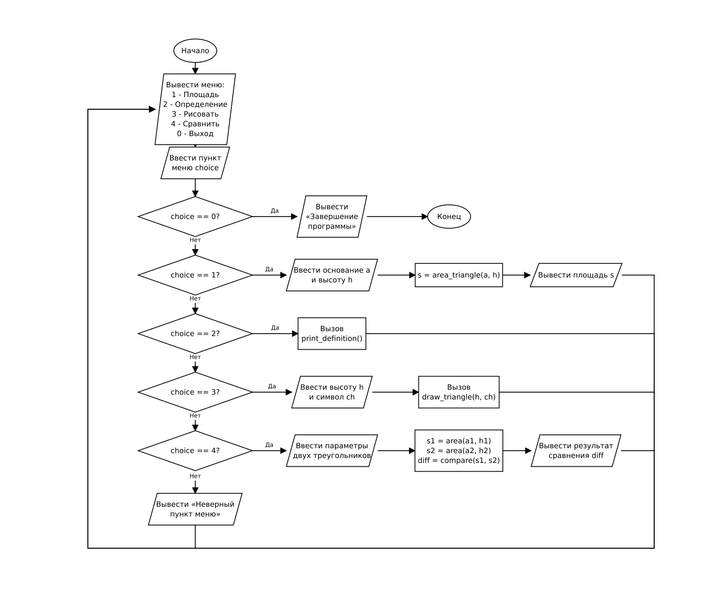

# Домашнее задание к работе 10

## Условие задачи (Вариант 2)

Составить программу, которая для заданной в **ДЗ к лабораторной работе № 6** и **ДЗ к лабораторной работе № 9** геометрической фигуры «Равнобедренный треугольник» (ограниченной прямыми $y_1 = x + 4$, $y_2 = -x + 4$ и осью $Ox$) предлагает меню выбора одной из операций:

1) рассчитать площадь;
2) вывести определение фигуры;
3) нарисовать фигуру;
4) сравнить два треугольника по площади;
0) выход.

Для заданной фигуры реализовать отдельные функции:
- `double area_triangle(double a, double h)` — вычисление площади треугольника по основанию и высоте ($S = \frac{1}{2} a \cdot h$);
- `void print_definition(void)` — вывод определения и геометрических свойств фигуры;
- `void draw_triangle(int h, char ch)` — отрисовка треугольника заданной высоты указанным символом;
- `double compare_triangles(double s1, double s2)` — вычисление разности площадей двух треугольников ($s_1 - s_2$).

---

## 1. Алгоритм и блок-схема

### Алгоритм

1. Настроить русскую локализацию для корректного вывода сообщений.
2. Организовать цикл `do-while` для циклического отображения меню и выбора пользователем необходимого действия.
3. Вывести пункты меню:
   - `1` — рассчитать площадь фигуры;
   - `2` — вывести определение фигуры;
   - `3` — нарисовать фигуру;
   - `4` — сравнить два треугольника по площади;
   - `0` — завершить работу.
4. Считать выбранный пункт `choice`.
5. С помощью оператора `switch` выполнить выбранную ветвь:
   - **Ветвь 1:** запросить у пользователя основание `a` и высоту `h`. Проверить условие корректности (`a > 0` и `h > 0`). При корректных данных вызвать функцию `area_triangle(a, h)` и вывести результат.
   - **Ветвь 2:** вызвать функцию `print_definition()`, выводящую текст с определением равнобедренного треугольника.
   - **Ветвь 3:** запросить высоту фигуры `draw_h` и символ `ch`. Проверить условие корректности (`draw_h > 0`). При корректных данных вызвать функцию `draw_triangle(draw_h, ch)`, выполняющую отрисовку с помощью двух вложенных циклов.
   - **Ветвь 4:** запросить основание и высоту для двух треугольников (`a1, h1` и `a2, h2`). Рассчитать их площади с помощью `area_triangle`, затем вызвать функцию `compare_triangles(s1, s2)` и вывести сообщение о том, какая фигура больше и на какую величину (либо об их равенстве).
   - **Ветвь 0:** вывести сообщение о завершении программы.
   - **По умолчанию (default):** вывести сообщение о неверном пункте меню.
6. Повторять цикл, пока пользователь не введёт пункт `0`.

### Блок-схема



*Исходник схемы для draw.io: [Lab10_AlgSchema.drawio](Lab10_AlgSchema.drawio)*

---

## 2. Реализация программы

Исходный код программы: [Source.c](Source.c)

---

## 3. Результаты работы программы

Пример 1 — Расчёт площади равнобедренного треугольника (пункт 1):

```
Меню операций для равнобедренного треугольника:
1 - Рассчитать площадь фигуры
2 - Вывести определение фигуры
3 - Нарисовать фигуру
4 - Сравнить два треугольника по площади
0 - Выход
Выберите операцию: 1
Введите длину основания: 8
Введите высоту: 4
Площадь треугольника: 16.00
```

Пример 2 — Вывод определения фигуры (пункт 2):

```
Меню операций для равнобедренного треугольника:
1 - Рассчитать площадь фигуры
2 - Вывести определение фигуры
3 - Нарисовать фигуру
4 - Сравнить два треугольника по площади
0 - Выход
Выберите операцию: 2
Равнобедренный треугольник — треугольник, у которого две стороны равны между собой.
```

Пример 3 — Отрисовка фигуры (пункт 3):

```
Меню операций для равнобедренного треугольника:
1 - Рассчитать площадь фигуры
2 - Вывести определение фигуры
3 - Нарисовать фигуру
4 - Сравнить два треугольника по площади
0 - Выход
Выберите операцию: 3
Введите высоту треугольника: 4
Введите символ для рисования: *
   *
  ***
 *****
*******
```

Пример 4 — Сравнение двух треугольников по площади (пункт 4):

```
Меню операций для равнобедренного треугольника:
1 - Рассчитать площадь фигуры
2 - Вывести определение фигуры
3 - Нарисовать фигуру
4 - Сравнить два треугольника по площади
0 - Выход
Выберите операцию: 4
Первый треугольник:
Введите основание и высоту: 10 5
Второй треугольник:
Введите основание и высоту: 6 3
Площадь первого: 25.00, площадь второго: 9.00
Первый треугольник больше второго на 16.00
```

Пример 5 — Завершение работы программы (пункт 0):

```
Меню операций для равнобедренного треугольника:
1 - Рассчитать площадь фигуры
2 - Вывести определение фигуры
3 - Нарисовать фигуру
4 - Сравнить два треугольника по площади
0 - Выход
Выберите операцию: 0
Завершение программы.
```

---

## 4. Информация о разработчике

- **ФИО:** Аносов Сергей Юрьевич
- **Группа:** бОТИ-261
